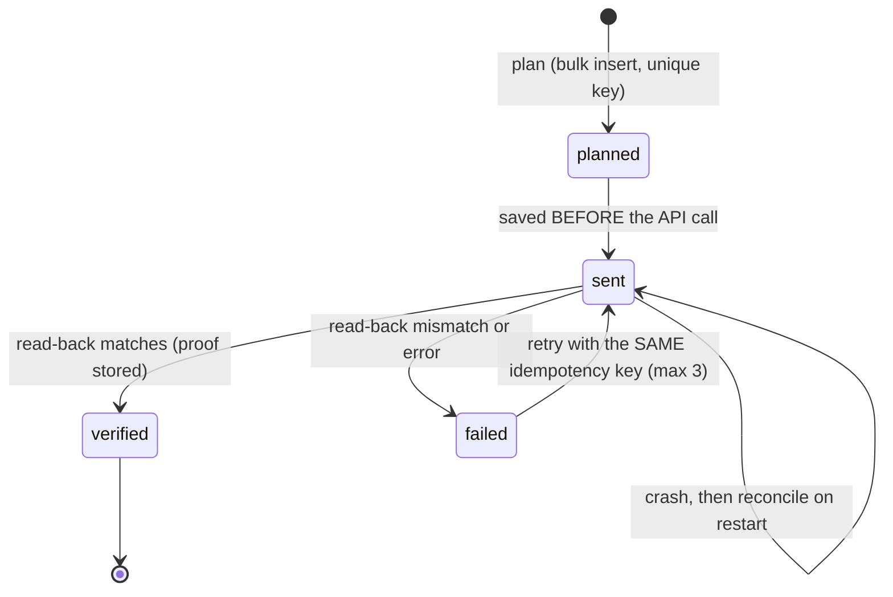
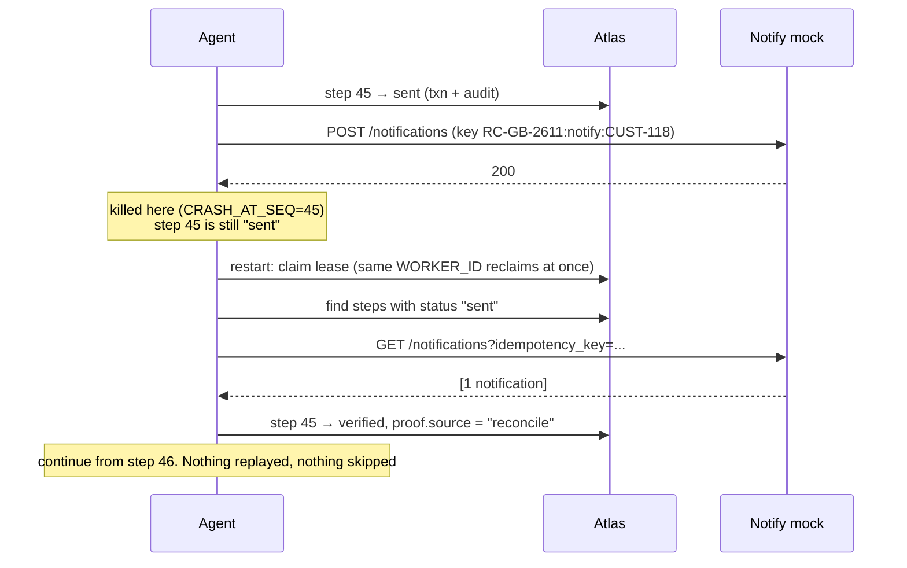
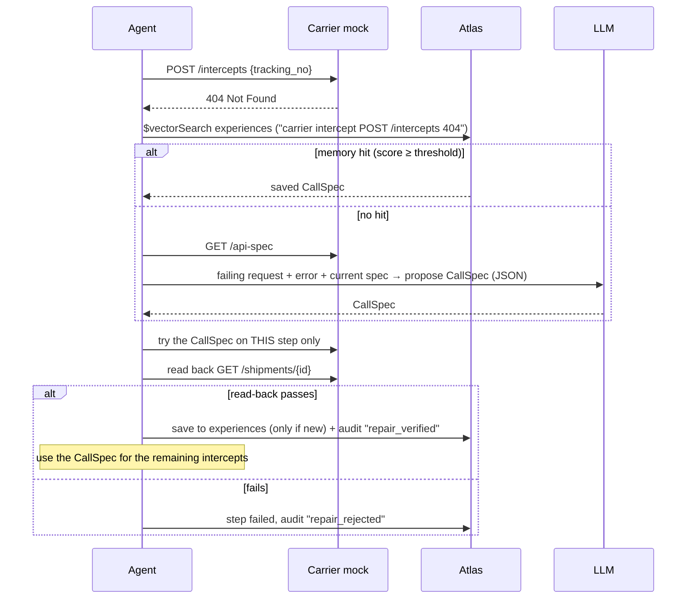

# 02 · Architecture

## Components

```
                            HTTP (Idempotency-Key header on every write)
┌─────────────────────────┐ ───────────────────────────────▶ ┌───────────────────────────────┐
│ Agent  (agent/, A)      │                                   │ Warehouse mock   :8001  (C)  │
│  scope → plan → policy  │ ◀───── read back every write ──── │ Orders mock      :8002  (C)  │
│  → send → verify        │                                   │ Carrier + notify :8003  (C)  │
│  repair (LLM) on errors │                                   │  each: /chaos, /reset         │
└───────────┬─────────────┘                                   └───────────────────────────────┘
            │ pymongo (store/, B)                                         ▲ chaos buttons
            ▼                                                             │
┌───────────────────────────────────────────────┐     ┌───────────────────┴───────────┐
│ MongoDB Atlas · database `tracer`             │     │ Live log  :8000  (web/, C)    │
│  steps · audit_log · experiences · control    │ ──▶ │ change stream → browser (SSE) │
└───────────────────────────────────────────────┘     │ countdown, chaos, kill button │
                                                      └───────────────────────────────┘
```

| Component | Owner | Job |
|---|---|---|
| `agent/` | A | The loop: scope the lot, plan steps, check policy, call the systems, read back, repair |
| `store/` | B | Every MongoDB read and write. The agent never touches `pymongo` directly; it calls `store` functions |
| `mocks/` | C | Three fake business systems with in-memory state, seeded data and chaos toggles |
| `web/` | C | The live log page and the chaos/kill buttons |
| Atlas | B | The agent's memory: task state, audit trail, learned fixes, pause flag and lease |

**Why the mocks keep their state in memory, not in Atlas:** they stand in for *someone else's* systems. If the agent could read their state from its own database, read-back would prove nothing. Keeping them separate makes the verification honest. Their state survives an agent crash because they run as separate processes.

## The step lifecycle



Rules:

1. **Only `verified` counts as done.** The report counts `verified` steps, never `sent`.
2. **Write-ahead intent.** The step is saved as `sent` *before* the HTTP call. If we crash during the call, the database still knows we may have acted.
3. **A 200 is not proof.** After every write, fetch the record and compare. Store what you saw in `proof`.
4. **Same key forever.** A step's idempotency key never changes across retries or restarts: `{recall_id}:{verb}:{target_id}`.
5. **One transaction per transition.** The step's status change and its `audit_log` entry commit together, so the audit trail can never disagree with the state.
6. **The database enforces it.** The `$jsonSchema` validator rejects a `verified` step that has no `proof`. Even a bug in the agent can't fake success.

## Flow 1: happy path

```
start(recall_id)
  claim lease in `control`                 # only one worker runs this recall
  if no steps exist for recall: plan()     # scope via mock list endpoints, bulk insert `planned`
  reconcile()                               # handles leftovers from a crash (no-op on first run)
  for step in steps where status in (planned, failed) order by seq:
      if paused(): stop                     # pause flag, checked before every step
      policy_check(step) or deny + audit
      mark_sent(step)                       # txn: status=sent, attempts+=1, audit "sent"
      call system (Idempotency-Key header)
      observed = read_back(step)
      if matches: mark_verified(step, proof)   # txn: status=verified, proof, audit "verified"
      else:       mark_failed(step, error)     # txn: status=failed, last_error, audit "failed"
  repeat the loop until every step is verified or has failed 3 times
  write report
```

Step order: holds (seq 1–20) → cancels (21–30) → intercepts (31–38) → notifications (39–60). Stop the spread first, then tell people.

## Flow 2: silent failure (drop writes)

1. Judge presses **drop writes** on the warehouse: the next 2 writes return `200` but change nothing.
2. Agent marks step `sent`, calls hold, gets `200`.
3. Read-back shows `status: "available"`, not `"hold"` → step `failed`, `last_error` = "read-back mismatch".
4. The retry pass sends the same call with the **same key** → the hold applies → `verified`.

The live log shows the step go `sent → failed → sent → verified`, with `attempts: 2`.

## Flow 3: crash and resume



Reconcile rules for each `sent` step:

| Read-back shows | Meaning | Action |
|---|---|---|
| Effect is there | The call landed before the crash | `verified`, `proof.source = "reconcile"`. **Don't call again** |
| Effect is missing | The crash happened before the call landed | Send again with the **same key** |
| Notifications count > 1 | Should never happen | `failed`, audit `"duplicate_detected"`, alert in the live log |

**Why this matters for notifications:** the notify mock deliberately does **not** de-duplicate (like real SMS and email gateways). If the agent replayed step 45, the customer would get two notices. Only reconcile prevents that. That's the line for the judges: *"Most agents would redo this step or skip it. Both are wrong. Watch it check the real system instead."*

**The lease:** `control.lease_owner` is the worker ID (`WORKER_ID` env, default `worker-1`), with `lease_expires` 15 seconds out, renewed every step. A restarted process with the same `WORKER_ID` reclaims its own lease immediately. A *different* worker must wait for the lease to expire. That's what stops two agents notifying the same customers at once.

## Flow 4: API change → repair → memory



- **CallSpec** is how the agent describes one API call: method, path template, body template, read-back path, the field to check and the expected values. Exact shape in [03-contracts.md §6](03-contracts.md#6-callspec-and-the-repair-contract).
- **Tested on one step first.** A wrong LLM guess costs one failed step, not 8.
- **Saved only after read-back passes.** Memory only holds fixes that are proven to work.
- **Recall 2** (`RC-OB-3107`, a different lot) hits the same carrier change. Memory returns the saved CallSpec, so there's no LLM call and the fix works first try. The report compares recall 1 and recall 2: failed attempts, LLM calls, time to recover.
- **Why vector search, not exact match:** the error text varies (different IDs, paths, wording). Similar situations should find the same fix.

## Flow 5: pause

A reviewer sets `control.paused = true` (from the live log or Atlas). The agent checks the flag before each step and stops within one step, audit `"paused"`. Setting it back to `false` and restarting continues from where it stopped. Start by reading the `control` document before every step (one cheap query). Upgrade to a change stream if time allows.

## Policy gate

Before any write, `policy_check(step)` must pass:

- the target's lot equals the recall's lot
- the action is one of the four recall actions
- the system is one of the four known systems

A denied target is **not** turned into a step. It gets an `audit_log` entry with `event: "denied"` and the reason. The warehouse mock's lot search is deliberately fuzzy and returns one unit from lot `GB-2612`, so the gate has something real to deny in the demo.

## What the live log shows

One line per step event, newest at the top, colour by status, streamed from a change stream on `steps` and `audit_log`:

```
11:02:14  #45  notify    CUST-118   sent       attempt 1
11:02:14  #45  notify    CUST-118   verified   proof: 1 notification (reconcile)
11:02:15  #31  carrier   TRK-5001   failed     POST /intercepts → 404
11:02:19  #31  carrier   TRK-5001   verified   repaired via LLM, saved to memory
```

Header: recall ID, verified/total counter, **countdown to the next truck pickup**, chaos buttons, kill and restart buttons.
